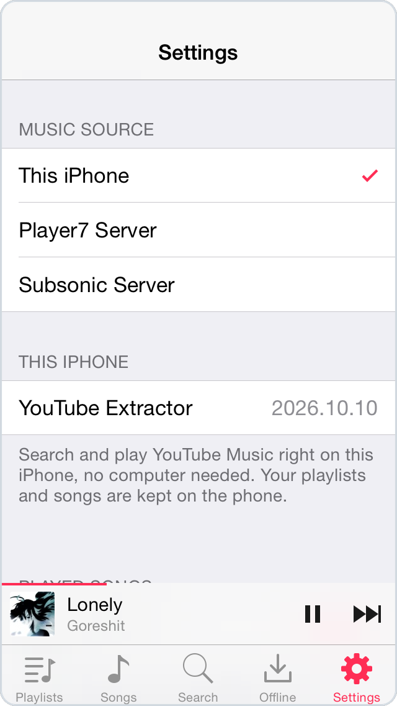

# Player7

A music player for old iPhones, modeled on the iOS 7 Music app. It plays YouTube Music and YouTube directly on the phone, with no account or server needed. It can also play from a Subsonic server such as Navidrome, or from its own optional self-hosted server, which adds Spotify and SoundCloud.

It runs on legacy iOS, from iOS 7.1 through iOS 10, where the official YouTube and Spotify apps no longer work.

<p align="center">
  
  
  
</p>
<p align="center">
  
  
  
</p>

Screenshots from an iPhone 5c on iOS 7.1.2.

## Features

- Search YouTube Music for songs, artists, albums and playlists, or search YouTube for any video
- Import YouTube albums, playlists and channels into a library kept on the phone
- Download songs for offline listening; songs you play are also cached automatically
- Up Next queue, shuffle, repeat and a sleep timer
- Lock screen, Control Center and AirPlay controls
- Play your own music from a Subsonic server
- Optional companion server that adds Spotify, SoundCloud and Last.fm

## Requirements

- iPhone 4, 4S, 5, 5c or 5s, or iPod touch (5th generation). iPads run it in iPhone mode.
- iOS 7.1 to iOS 10. Player7 is a 32-bit app, so iOS 11 and later can't run it.

## Installation

Download the `.deb` or `.ipa` from [Releases](../../releases).

- On a jailbroken device, install the `.deb` with Filza, or over SSH with `dpkg -i` followed by `uicache`.
- On a device that isn't jailbroken, sideload the `.ipa` with a tool that supports your iOS version. With AppSync Unified, the `.ipa` can also be installed directly.

The app is called **Music** on the home screen and opens on the Search tab.

## Music sources

Pick a source under **Settings > Music Source**.

### This iPhone

The default. It needs no setup. Use the **YT Music** tab to search songs and albums, and the **YouTube** tab to search videos, including long mixes and live recordings. To import an album, playlist or channel, tap **+** on the Playlists tab, choose **Import from Link**, and paste a YouTube or YouTube Music link.

Age-restricted videos and videos made for kids can't be played, and live streams don't appear in search. Spotify and SoundCloud need the Player7 server.

### Subsonic Server

Works with Navidrome, Airsonic, Gonic and other Subsonic-compatible servers. Enter the server address (for example `http://192.168.1.20:4533`), your username and password, then tap **Test Connection**. Your playlists, starred albums and starred artists show up on the Playlists tab. **Love** in the Now Playing menu stars a song. Formats the iPhone can't play, such as FLAC, Ogg and Opus, are converted to MP3 by the server.

### Player7 Server

The server in `server/` adds Spotify and SoundCloud search and imports, imports of whole Spotify profiles, your YouTube Music library, and Last.fm scrobbling. It runs on anything with Docker or Python, such as a Mac, a Linux machine, a Raspberry Pi or a NAS. See [Running the server](#running-the-server).

YouTube is still searched and played by the phone itself, since YouTube often blocks servers, especially ones in data centers. To let the server handle YouTube with yt-dlp instead, turn on **YouTube via Server** in Settings.

Songs play from wherever they came from, so you can switch sources without breaking the queue: Spotify and SoundCloud songs keep playing from the server after you switch to **This iPhone**, and Last.fm scrobbling keeps going through the server too.

## Running the server

With Docker:

```sh
cd server
docker compose up -d
```

Without Docker, you need Python 3.10 or later and ffmpeg. [Deno](https://deno.com) is recommended, because yt-dlp needs it for some YouTube videos.

```sh
cd server
./setup.sh
python3 server.py
```

On startup the server prints its address, for example `http://192.168.1.20:8787`. In the app, choose **Player7 Server**, enter that address and tap **Test Connection**.

### Configuration

All settings are optional. Set them as environment variables (for example in `docker-compose.yml`) or in `server/config.json`; `config.example.json` is a starting point. Values in `config.json` take precedence.

| config.json | Environment variable | Purpose |
|---|---|---|
| `token` | `PLAYER7_TOKEN` | Token the app must send. Enter the same token in the app's Settings. Set one if anyone else can reach the server. |
| `spotify_client_id`, `spotify_client_secret` | `SPOTIFY_CLIENT_ID`, `SPOTIFY_CLIENT_SECRET` | Spotify search and artist pages. Create an app at <https://developer.spotify.com/dashboard>. Importing Spotify playlists and albums works without them. |
| `spotify_market` | `SPOTIFY_MARKET` | Two-letter country code used for Spotify availability. Defaults to `US`. |
| `lastfm_api_key`, `lastfm_api_secret` | `LASTFM_API_KEY`, `LASTFM_API_SECRET` | Last.fm scrobbling. Get a key at <https://www.last.fm/api/account/create>, then connect in the app's Settings. |
| `youtube_proxy` | `YOUTUBE_PROXY` | Proxy for yt-dlp, if YouTube blocks the server's IP address. This happens more often on cloud servers than on home connections. |
| | `PORT` | Port to listen on. Defaults to `8787`. |

To import your YouTube Music library (liked songs and private playlists), run `.venv/bin/ytmusicapi browser`, follow its instructions, and save the output as `server/secrets/ytmusic_browser.json`. Then import `ytmusic` from the app.

To download audio from Spotify instead of matching songs on YouTube (Spotify Premium required), run `.venv/bin/pip install -r requirements-spotify.txt` and then `.venv/bin/python spotify_dl.py login`. Check Spotify's terms of service first.

### Security

The server speaks plain HTTP, so traffic between it and the app isn't encrypted. Keep the server on your local network, set a token, and don't expose its port to the internet. To use it away from home, connect through a VPN; iOS 7 includes L2TP and IPSec clients.

## How it works

iOS 7 trusts only the root certificates it shipped with in 2014, so it rejects many sites today. Player7 bundles the current Mozilla root certificates (`Resources/cacert.pem`) and checks connections against them when the system check fails.

The app runs a small HTTP server on `127.0.0.1` that implements the same API as the Player7 server, so the rest of the app works the same way with every source. It also relays HTTPS audio, so the player only receives plain HTTP from the phone itself.

YouTube serves audio as fragmented MP4, which the media player on iOS 7 to 9 can't open. The built-in server rebuilds the file's index and passes the player a regular MP4. The audio data is copied unchanged, without re-encoding, and seeking and downloads work as usual.

The YouTube code lives in `Resources/extractor.js` and runs in JavaScriptCore. Since YouTube changes often, the app can download a newer version of this file without being reinstalled (see [Building](#building)).

## Troubleshooting

**A YouTube song doesn't play.** YouTube probably changed something. An updated `extractor.js` usually fixes it, and the app downloads one automatically if your build has an update URL set. With a Player7 server, **YouTube via Server** plays YouTube through yt-dlp instead.

**The app can't connect to a server.** Check that the phone and the server are on the same network, that the address includes the port, and that the token or password is correct.

## Building

You need [Theos](https://theos.dev) with the iOS 9.3 SDK in `$THEOS/sdks`.

```sh
make                          # debug build
./dev.sh ipa                  # release .ipa in packages/
make package FINALPACKAGE=1   # release .deb in packages/
```

`dev.sh` also builds, installs and shows logs for a phone connected over USB. Debug builds accept `player7://` URLs for scripted testing (see `Sources/P7Debug.h`); release builds ignore them.

Before publishing a build, set `kP7ExtractorUpdateURL` in `Sources/P7Script.m` to the raw URL of `Resources/extractor.js` in your repository. To ship a fix later, edit `extractor.js`, increase `extractor.version`, and push. Installed apps check for a new version once a day.

## License

[MIT](LICENSE)

## Disclaimer

Player7 is not affiliated with Apple, Google, YouTube, Spotify or SoundCloud. It is intended for personal use. Only play content you have the right to access, and follow the terms of the services you use.
