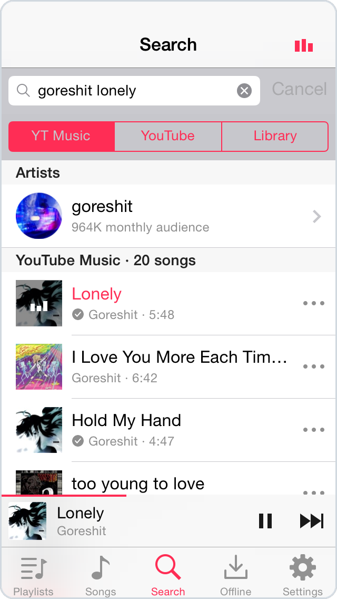
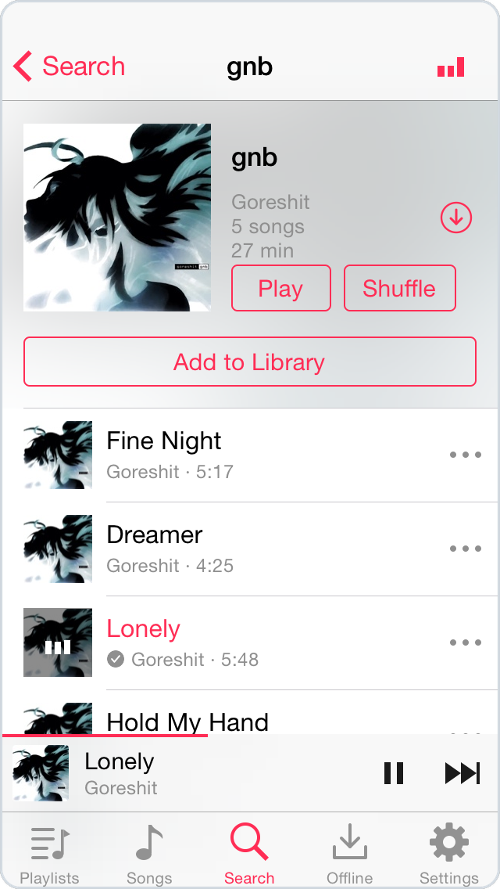
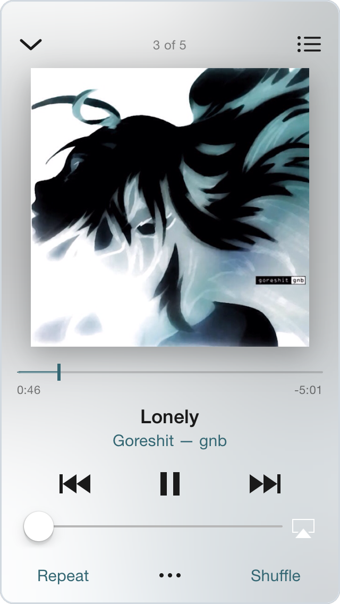
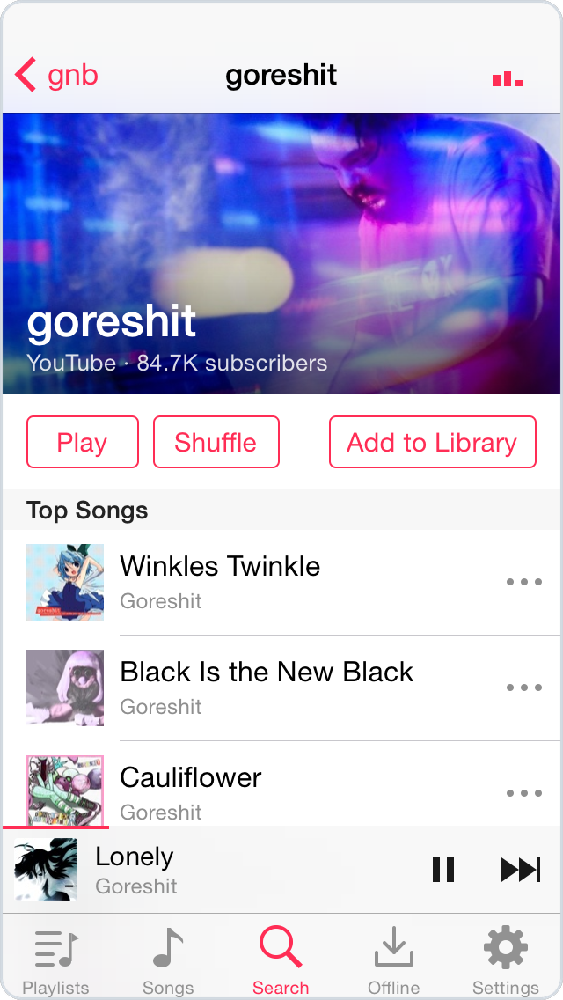
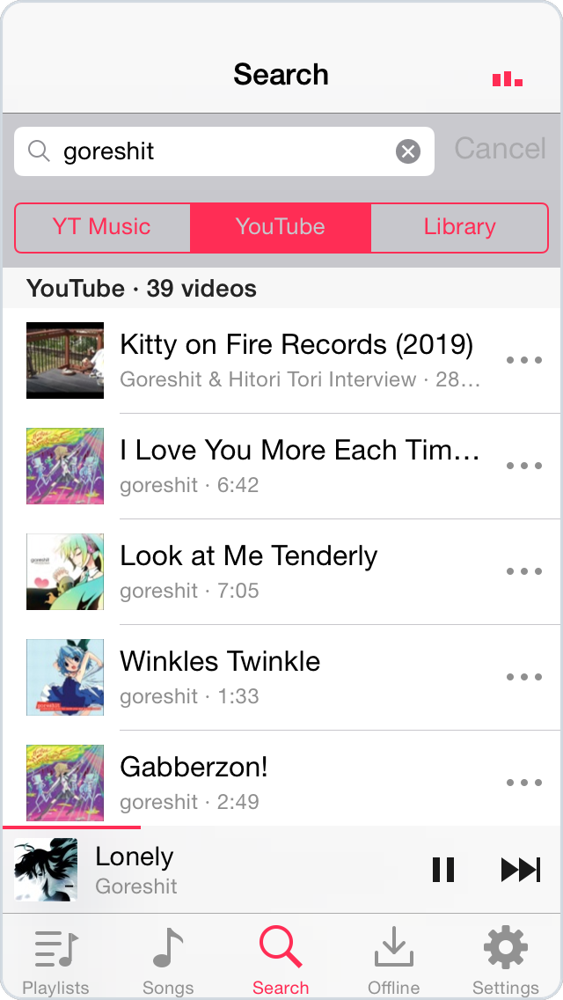
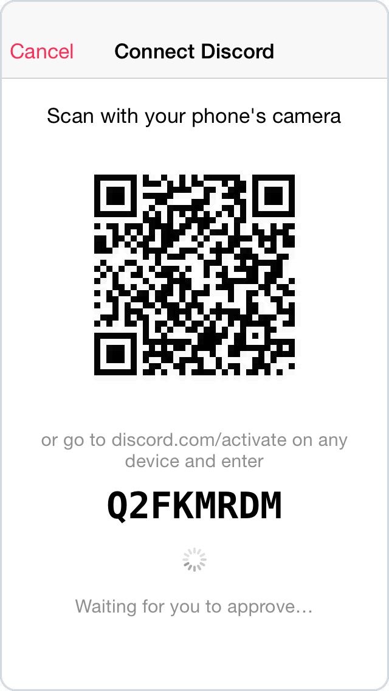

# Player7

The iOS 7 Music app, brought back to life on old iPhones.

Player7 turns an old iPhone into an iPod again. It looks and feels like the Music app from 2013, but it plays today's music: all of YouTube Music and YouTube, streamed and saved for offline right on the phone, with no account, server or computer needed. Point it at a Subsonic server for your own collection, or at the optional Player7 server for Spotify and SoundCloud.

It runs on legacy iOS, from iOS 7.1 through iOS 10, on phones the official YouTube and Spotify apps dropped years ago.

<p align="center">
  
  
  
</p>
<p align="center">
  
  
  
</p>

Screenshots from an iPhone 5c on iOS 7.1.2.

## Features

- Search YouTube Music for songs, artists, albums and playlists, or plain YouTube for live sets, mixes and everything else
- Keep a library on the phone: import albums, playlists and channels from a link
- Every song you play is saved for offline listening, and whole playlists download with one tap
- Up Next, shuffle, repeat and a sleep timer, with lock screen, Control Center and AirPlay controls
- Scrobble to Last.fm straight from the phone
- Show what you're listening to on your Discord profile, with the cover and a progress bar; you link your account by scanning a QR code
- Play your own collection from Navidrome or any other Subsonic server
- Add Spotify and SoundCloud with an optional server you run yourself

## Requirements

- iPhone 4, 4S, 5, 5c or 5s, or iPod touch (5th generation). iPads run it in iPhone mode.
- iOS 7.1 to iOS 10. Player7 is a 32-bit app, so iOS 11 and later can't run it.

## Installation

Download the `.deb` or `.ipa` from [Releases](../../releases).

- On a jailbroken device, install the `.deb` with Filza, or over SSH with `dpkg -i` followed by `uicache`.
- On a device that isn't jailbroken, sideload the `.ipa` with a tool that supports your iOS version. With AppSync Unified, the `.ipa` can also be installed directly.

The app is called **Music** on the home screen and opens on the Search tab.

## Music sources

Pick one under **Settings > Music Source**.

- **This iPhone** (default): YouTube Music and YouTube, nothing to set up. Import albums, playlists and channels with **+** on the Playlists tab.
- **Subsonic Server**: Navidrome, Airsonic, Gonic and the like. Enter the address, username and password.
- **Player7 Server**: adds Spotify and SoundCloud, plus imports of Spotify profiles and your YouTube Music library. YouTube still plays on the phone unless you turn on **YouTube via Server**.

Songs keep playing from where they came from, so switching sources doesn't break the queue.

## Last.fm and Discord

Both run on the phone, with any music source. In Settings, tap **Connect to Last.fm** and log in, or tap **Connect Discord** and scan the QR code with your main phone.

## Running the server

```sh
cd server
docker compose up -d
```

Or without Docker (Python 3.10+, ffmpeg, and [Deno](https://deno.com) for yt-dlp):

```sh
cd server
./setup.sh
python3 server.py
```

It prints its address on startup; enter it in the app under **Player7 Server**. Settings go in `docker-compose.yml` or `server/config.json` (see `config.example.json`):

| config.json | Environment variable | Purpose |
|---|---|---|
| `token` | `PLAYER7_TOKEN` | Token the app must send. Set one if anyone else can reach the server. |
| `spotify_client_id`, `spotify_client_secret` | `SPOTIFY_CLIENT_ID`, `SPOTIFY_CLIENT_SECRET` | Spotify search and artist pages ([create an app](https://developer.spotify.com/dashboard)). |
| `spotify_market` | `SPOTIFY_MARKET` | Country for Spotify availability. Defaults to `US`. |
| `youtube_proxy` | `YOUTUBE_PROXY` | Proxy for yt-dlp if YouTube blocks the server. |
| | `PORT` | Defaults to `8787`. |

For your YouTube Music library, save the output of `.venv/bin/ytmusicapi browser` as `server/secrets/ytmusic_browser.json`. For audio straight from Spotify (Premium), run `.venv/bin/pip install -r requirements-spotify.txt` and `.venv/bin/python spotify_dl.py login`.

The server speaks plain HTTP: keep it on your home network or behind a VPN.

## Building

You need [Theos](https://theos.dev) with the iOS 9.3 SDK.

```sh
make                          # debug build
make package FINALPACKAGE=1   # release .deb
./dev.sh ipa                  # release .ipa
```

Scrobbling needs a [Last.fm API key](https://www.last.fm/api/account/create) in `local.mk`, which isn't committed:

```make
LASTFM_API_KEY = your-api-key
LASTFM_API_SECRET = your-shared-secret
```

Forks should also set their own Discord application in `Sources/P7Discord.m` and the extractor update URL in `Sources/P7Script.m`.

## License

[MIT](LICENSE)

## Disclaimer

Player7 is not affiliated with Apple, Google, YouTube, Spotify or SoundCloud. It is intended for personal use. Only play content you have the right to access, and follow the terms of the services you use.
